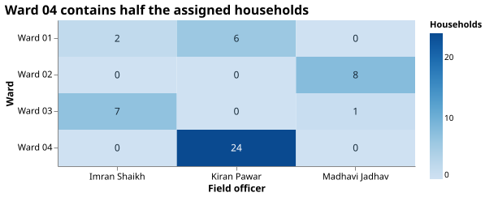
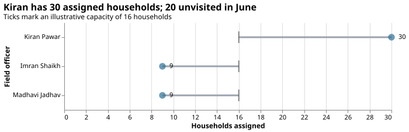
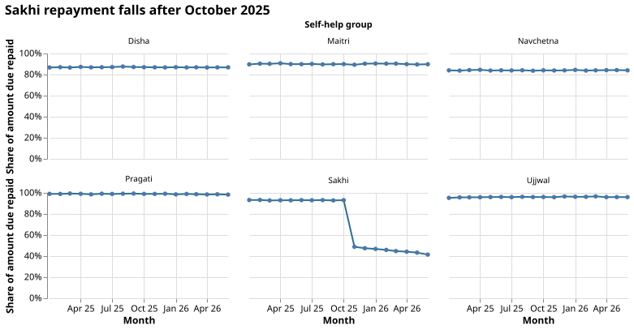
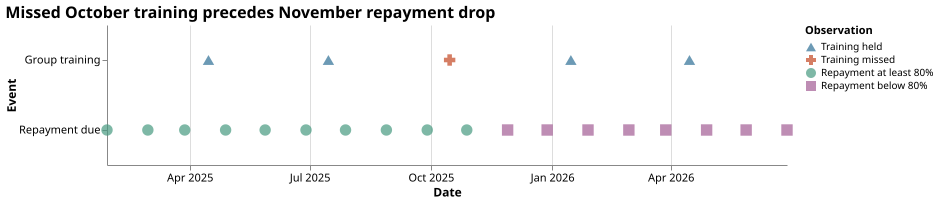
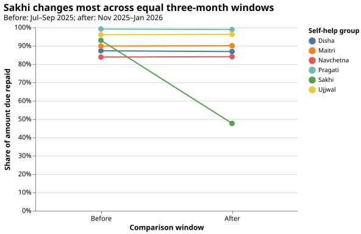
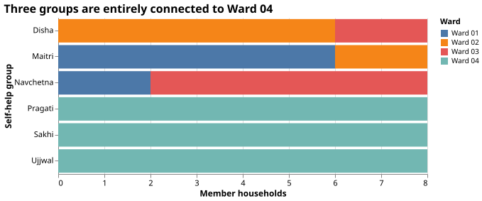
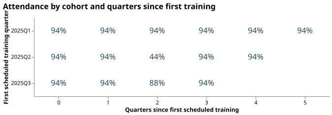

# Related NGO sheets and varied relationship visuals

Entirely synthetic Sahyog Livelihoods data, January 2025–June 2026 (18 months).
Names and places are invented combinations; no private files or accounts were used.

| Workbook | Sheets and row grain | Rows | Joins |
| --- | --- | ---: | --- |
| [households.xlsx](fixtures/households.xlsx) | Households: one household | 48 | `household_id`; assigned officer and ward |
| [groups.xlsx](fixtures/groups.xlsx) | Groups: one group; Members: one household membership | 6; 48 | `group_id`, `household_id` |
| [loans.xlsx](fixtures/loans.xlsx) | Loans: one loan; Repayments: one loan/month | 48; 864 | `loan_id`, `household_id`, `group_id` |
| [field_visits.xlsx](fixtures/field_visits.xlsx) | Visits: one officer visit to a household | 458 | `household_id`, officer |
| [trainings.xlsx](fixtures/trainings.xlsx) | Trainings: one scheduled group session | 30 | `group_id`, date |

Each workbook includes a Notes sheet with assumptions. Deliberate mess includes
spaces/case in wards and statuses, Excel dates mixed with ISO date strings, rupee
amounts stored as text, and blank livelihoods, notes, receipt dates, payment amounts,
and one attendance count. Stable join IDs remain clean.

Planted patterns: Ward 04 contains 24/48 households; Kiran covers 30 households while
the other officers cover nine each (20 of Kiran's households have no June visit);
Sakhi misses its 15 October 2025 training and repayment drops in November.
This sequence is synthetic association, not evidence that training caused repayment.

## Questions, chart choices, and thumbnails

Click a thumbnail to see its full SVG. Each has a same-stem `.csv` and `.vl.json` in
[`out/`](out/); the spec intentionally omits data for `idli_show`'s local CSV loading.
Every chart uses an actual [skill template](../2026-11-06-oss-desktop-independent/cowork/idli/claude-skills/relationship-visuals/templates/).

| Question | Chart family | Preview |
| --- | --- | --- |
| Where are household/officer connections concentrated? | Join matrix | [](out/01-matrix.svg) |
| Who has the largest caseload, and how many households went unvisited in June? | Ranked dots linked to an illustrative capacity of 16 | [](out/02-ranked-dot.svg) |
| Which group's monthly repayment diverges? | Small multiples by group | [](out/03-small-multiples.svg) |
| How does Sakhi's missed training line up with repayment? | Event strip | [](out/04-event-strip.svg) |
| Which groups changed between July–September and November–January? | Before/after slope | [](out/05-slope.svg) |
| How do household memberships connect groups to wards? | Bipartite-like layered bars | [](out/06-layered-bars.svg) |
| Do first-training cohorts sustain attendance at comparable stages? | Cohort table | [](out/07-cohort-table.svg) |

## Reproduce and verify

From the repository root, using a temporary environment:

```sh
python3 -m venv /tmp/relviz-venv
/tmp/relviz-venv/bin/python -m pip install -r benchmarks/runs/2026-11-14-relviz/requirements.txt
/tmp/relviz-venv/bin/python benchmarks/runs/2026-11-14-relviz/fixtures/generate.py
/tmp/relviz-venv/bin/python benchmarks/runs/2026-11-14-relviz/prove.py
/tmp/relviz-venv/bin/python benchmarks/runs/2026-11-14-relviz/check_launcher.py
```

The generator uses seed `20261114`; cell values are repeatable (XLSX ZIP metadata
may vary). `prove.py` reads the workbooks, checks unique keys and all foreign-key
matches, validates join cardinality, and checks the planted patterns. It aggregates
facts separately, writes CSV/spec pairs, and renders seven SVGs with `vl_convert`.
It reloads CSVs as strings, matching Idli, and checks nonempty SVG data marks and
seven distinct chart compositions. Failures exit nonzero; no renderer fallback.
[`out/validation.json`](out/validation.json) records versions, source columns, row
counts, blanks, findings, and checks for every chart.

Repayment shares use total known paid / corresponding total due: two unknown paid
amounts are excluded from both sums, leaving 862/864 installments. Slope windows
are Jul–Sep 2025 and Nov 2025–Jan 2026, excluding the event month. Attendance shares
use known attendees / eligible member-session slots: one unknown attendance count
is excluded from both sums, leaving 29/30 sessions; a missed training remains zero.
Cohorts start at first scheduled training; future quarters remain blank.

## Claude installation

The [skill](../2026-11-06-oss-desktop-independent/cowork/idli/claude-skills/relationship-visuals/SKILL.md)
contains the decision table, masked-value rules, consent requirement, and the rule
against consecutive repetition. The [launcher](../2026-11-06-oss-desktop-independent/cowork/desktop/claude-masked.sh)
copies `idli/claude-skills/*` recursively to `$IDLI_CLAUDE_WORK/.claude/skills/`
(default `~/idli-insights/claude-masked/.claude/skills/`) before starting Claude.
`check_launcher.py` tests initial install and refresh, nested templates, paths with
spaces, preserved custom skills, and forwarded arguments using a temporary home and
stubbed services. It never starts Claude or connects to live services.
